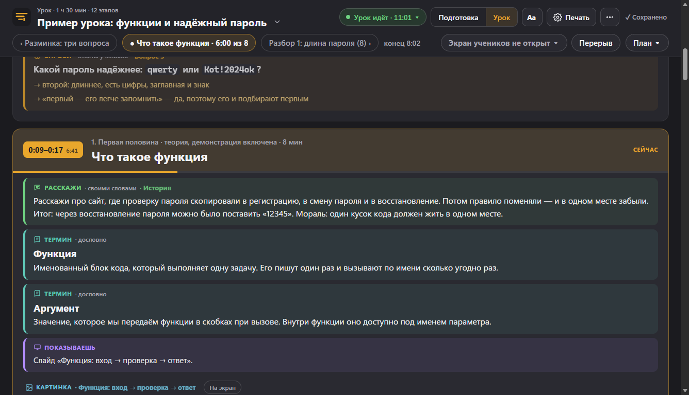
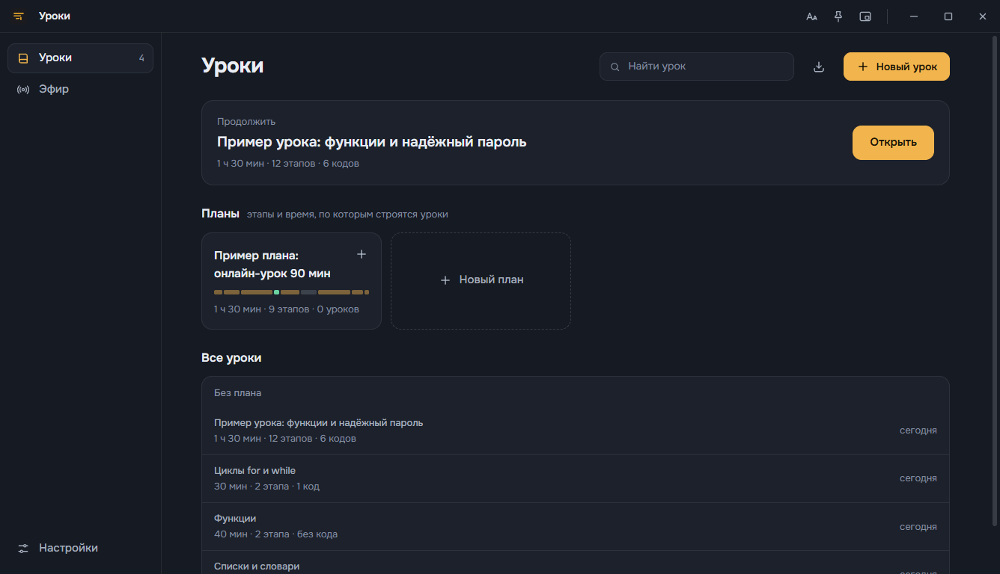
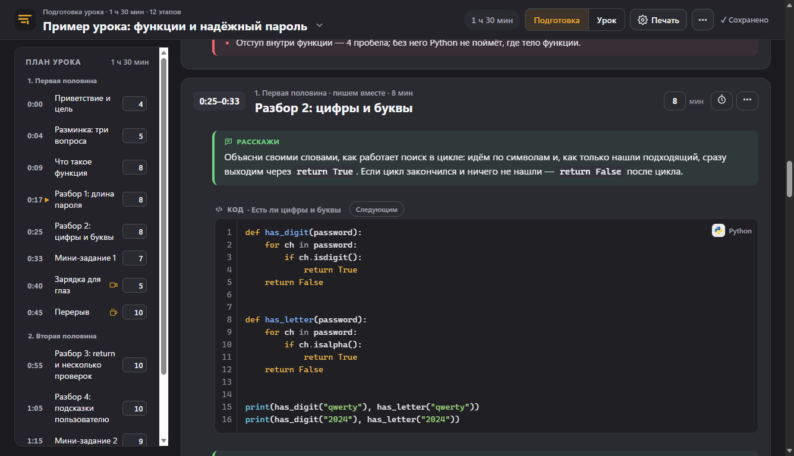
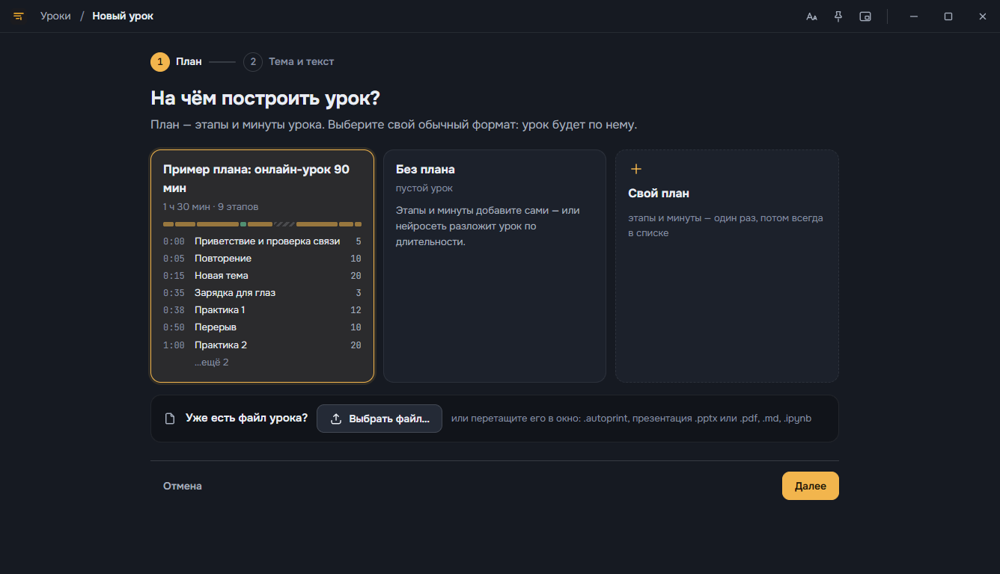
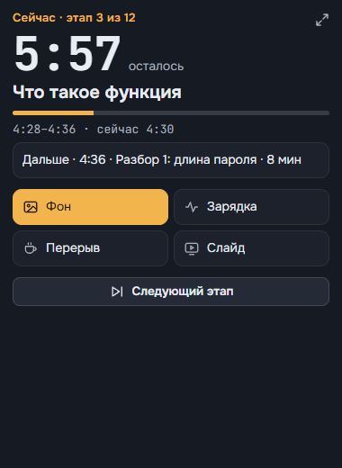
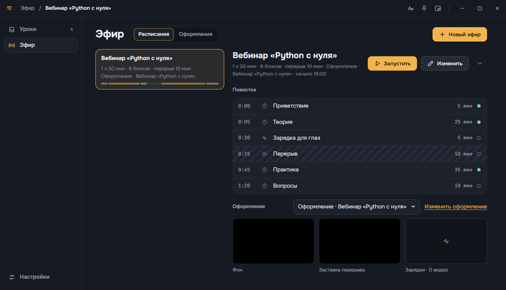
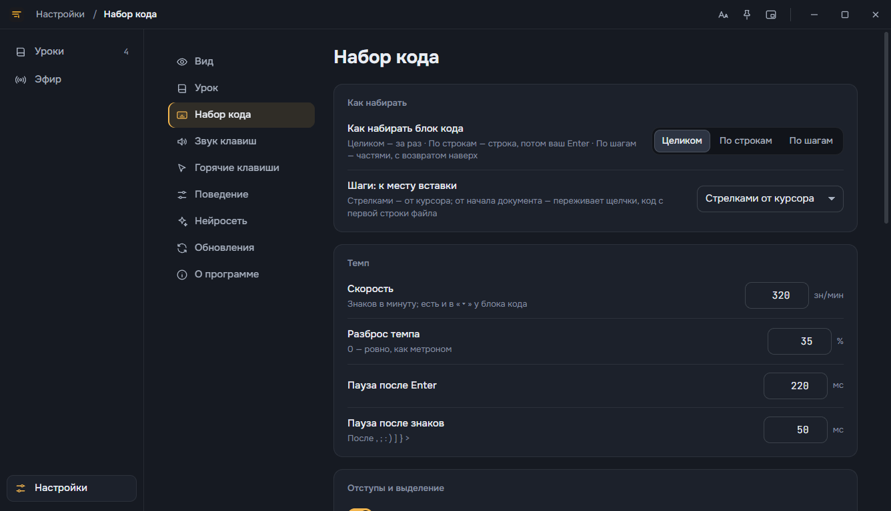
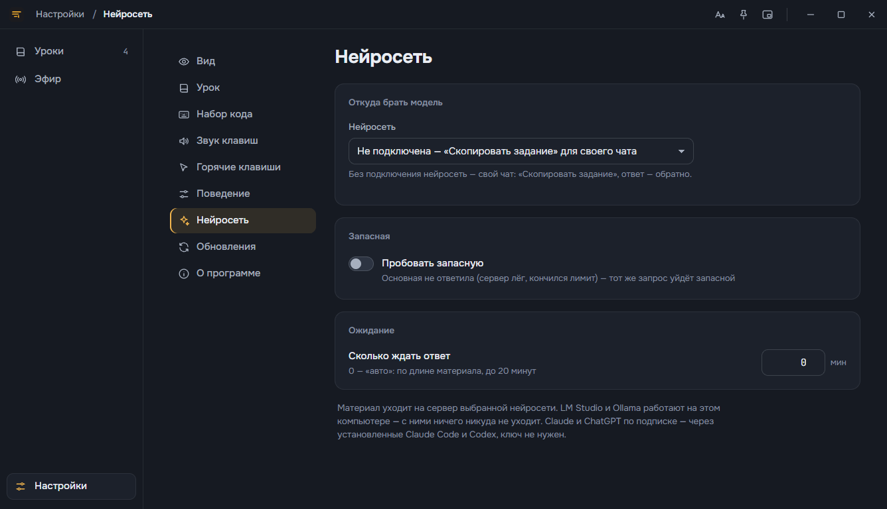

<div align="center">


# AutoPrintCode

**Ведёт урок по времени и печатает заготовленный код — как будто вы набираете его сами.**

План с минутами, что сказать дословно, что рассказать своими словами, что спросить — на экране урока.
Код набирается в VS Code, Jupyter, Colab или Блокнот с позиции курсора, в заданном темпе
и со звуком настоящей клавиатуры. Вы объясняете — код набирается.

[](https://github.com/DanT2000/AUTO_PRINT_CODE/releases/latest)

[](https://github.com/DanT2000/AUTO_PRINT_CODE/releases/latest)
[](#установка)
[](#из-исходников)

<br>

<picture>
  <source media="(prefers-color-scheme: light)" srcset="docs/images/lesson-light.png">
  
</picture>

<sub>Урок идёт: сверху — сколько осталось и план этапов по часам, рядом — экран учеников маленькими значками
(фон, зарядка, перерыв, слайд). Ниже — текущий этап; цвет плашки подсказывает, что делать: расскажи, термин, спроси.</sub>

</div>

<br>

## Для уроков и видеогайдов по программированию

Когда ведёшь или записываешь урок, приходится одновременно набирать код, объяснять, следить за временем
и за кадром. AutoPrintCode берёт набор и время на себя:

- **Одно окно.** Уроки, сам урок, «Эфир» и настройки — в одном окне программы со светлой и тёмной темой
  и масштабом. На уроке окно можно сделать маленьким — оно встанет поверх всех окон и покажет главное.
- **Урок по событиям, а не по часам.** Этапы с минутами, план — одной строкой сверху: что сейчас, сколько
  осталось, что дальше, когда конец. Программа сама ничего не сворачивает и не переключает: дочитали
  разминку — идёте дальше.
- **Экран учеников — рядом со статусом урока.** Фон, перерыв, зарядка, слайды — маленькие значки с подсказками
  наверху. Вкладку экрана вы захватываете в OBS, Zoom или Teams.
- **Новый урок по шагам.** Готовый план («онлайн 90 минут»…), свой план, урок нейросетью по файлу или теме,
  вставка готового текста — или вручную.
- **Урок по презентации.** PDF или PowerPoint — урок по слайдам: под каждым слайдом заметки докладчика.
  Ученики видят слайд на своём экране, вы листаете кликером ◀ ▶ и видите, что сказать.
- **Что говорить — цветом.** На этапе — плашки: **Говоришь** (обязательно и дословно: определения, тезисы),
  **Термин**, **Расскажи** (своими словами, можно отступить в сторону), **Спроси** (вопрос и ответы, которые
  обычно дают ученики), **Делаешь**, **Показываешь**, **Если застрял**, **Домашнее задание**, **Важно**.
- **Правка как в Word.** Щёлкнули по тексту — правите на месте: «Ж», «К», списки, ссылки. Разметки
  не видно, вставка из Word сохраняет жирный и списки.
- **Печатается только код.** Заметки — для вас, в редактор они не попадают. Напечатали блок — следующим
  встаёт следующий код урока: весь урок ведётся одной клавишей `Ctrl+F9`.

- **Меньше дублей и монтажа.** Код печатается без опечаток и без пауз на то, чтобы вспомнить
  следующую строку. Фрагмент получается с первого раза, не нужно вырезать ошибки и заминки.
- **Можно говорить, пока код набирается.** Печать идёт сама. Хоткей `Ctrl+F9` ставит её на паузу
  в любой момент, когда нужно что-то пояснить, и продолжает с того же места.
- **Зритель успевает следить.** Код появляется постепенно в заданном темпе, а не вставляется целиком
  через `Ctrl+V`. Скорость подбирается под аудиторию: медленнее для новичков, быстрее для опытных.
- **Выглядит как живое программирование.** Режим «Как человек» добавляет неровный ритм, паузы
  на обдумывание и опечатки, которые тут же исправляются. Звук настоящей клавиатуры поддерживает
  ощущение, что код набирают руками. Если звук пишется отдельно, его можно выключить.
- **Одинаковый темп от дубля к дублю.** Неудачный фрагмент легко переснять кнопкой «Сначала»
  и склеить с остальными: ритм не будет отличаться.
- **Код по частям.** Блок печатается целиком, по строкам (следующая — по вашему Enter) или по шагам, как
  объясняет преподаватель: с возвратом наверх и вставкой в середину.
- **Урок из методички или своего кода.** PDF, Word, PowerPoint, тетрадка Jupyter — нейросеть разложит
  материал по этапам и плашкам. Claude Code и Codex читают файл сами. Тетрадка-сценарий с ⏱ этапами и 🗣
  репликами распознаётся и без нейросети. Можно подключить нейросеть (в том числе Claude или ChatGPT по подписке)
  или скопировать задание в свой чат.
- **Чистый код в кадре, подсказка — над кодом.** Комментарии-подсказки в коде можно не печатать:
  в редактор попадёт код без них, а на экране урока над кодом — «Скажи: …».
- **Код в кадре — точно как в уроке.** Профиль IDE учитывает автоскобки и автоотступы редактора.
  Не придётся исправлять что-то на записи.
- **В настоящих инструментах.** Печать идёт в VS Code, Jupyter, Colab или Блокнот. Урок записывается
  в той же среде, в которой будет работать зритель.
- **Ничего лишнего не попадёт в кадр.** Хоткеи не доходят до редактора. Если сменилось активное окно,
  вы случайно нажали клавишу или щёлкнули мышью, печать встаёт на паузу, а случайная клавиша в код не попадает.
- **Окно урока — вне кадра.** Например, на втором мониторе: ученики видят только захваченную вкладку
  или окно редактора, а печать идёт по глобальным хоткеям.

## Как это выглядит

<table>
<tr>
<td width="50%" valign="top">

<p align="center"><sub><b>«Уроки»</b> — продолжить последний, планы (этапы и время, по которым строятся уроки) и все уроки по планам. Меню урока — одним списком.</sub></p>
</td>
<td width="50%" valign="top">

<p align="center"><sub><b>Подготовка.</b> Щёлкнули по заметке — правите на месте тем же шрифтом: «Ж», «К», списки, код, ссылка. Разметки не видно.</sub></p>
</td>
</tr>
<tr>
<td width="50%" valign="top">

<p align="center"><sub><b>«Новый урок»</b> по шагам: план, свой план, нейросеть по файлу или теме, вставить готовый текст или вручную.</sub></p>
</td>
<td width="50%" valign="top">

<p align="center"><sub><b>Маленький режим</b> — то же окно поверх всех: сколько осталось, что дальше, экран учеников и набор кода. Раскладка — по размеру окна.</sub></p>
</td>
</tr>
<tr>
<td width="50%" valign="top">

<p align="center"><sub><b>«Эфир»</b> — вебинар без урока: расписание по минутам, оформление экрана (фон, перерыв, зарядки), запуск по времени.</sub></p>
</td>
<td width="50%" valign="top">

<p align="center"><sub><b>Настройки</b> — разделами: вид, урок, набор кода, звук клавиш, хоткеи, поведение, нейросеть, обновления.</sub></p>
</td>
</tr>
</table>

## Установка

### Установщик (рекомендуется)

Скачайте `AutoPrintCode-X.Y.Z-Setup.exe` со страницы [последнего выпуска](https://github.com/DanT2000/AUTO_PRINT_CODE/releases/latest)
и запустите. Сначала Windows спросит, для кого ставить:

- **Для всех пользователей** (по умолчанию) — в `C:\Program Files\AutoPrintCode`, нужны права
  администратора. Занятия и настройки у каждого пользователя свои — в `%APPDATA%\AutoPrintCode`.
  Обновляется программа сама: скачивает установщик новой версии, сверяет его контрольную сумму и запускает
  его с запросом прав администратора.
- **Только для меня** — без прав администратора, в `%LOCALAPPDATA%\Programs\AutoPrintCode`; уроки и
  настройки — в папке `data` рядом с программой.

Затем установщик спросит, как ставить:

- **Установить** — ярлык в меню «Пуск» (и на рабочем столе — по желанию), удаление через
  «Параметры → Приложения». Если раньше программа стояла «только для меня», а теперь ставится для всех,
  прежняя копия удаляется, а её уроки и настройки программа перенесёт сама при первом запуске.
- **Обновить установленную версию** — если AutoPrintCode уже стоит: та же папка, без лишних вопросов.
  Занятия и настройки остаются.
- **Портативная версия** — просто папка с программой, например на флешке. В Windows ничего не
  прописывается, уроки и настройки лежат в папке `data` рядом с программой.

Windows SmartScreen может предупредить о неизвестном издателе (у программы нет платной цифровой подписи):
«Подробнее» → «Выполнить в любом случае».

### Портативная версия архивом

Там же, в выпуске, лежит `AutoPrintCode-X.Y.Z-win64.zip`: распакуйте куда угодно и запустите
`AutoPrintCode.exe`. Это то же самое, что «Портативная версия» в установщике.

### Из исходников

Нужны Windows, Python 3.10+ и Node.js 22 (для окна программы — Electron).

```
git clone https://github.com/DanT2000/AUTO_PRINT_CODE.git
cd AUTO_PRINT_CODE
pip install -r requirements.txt
cd window && npm ci && cd ..   # окно программы (Electron), один раз
python app.py        # или run.bat — без консоли
```

Без git можно скачать архив: на странице репозитория **Code → Download ZIP**.

При первом запуске создаётся папка `data/` с образцовым уроком и звуками клавиш. Она не хранится в
репозитории: у каждого своя база уроков и настроек.

**Версия для браузера** — интерфейс открывается страницей, печать идёт через локального помощника
на Node.js: `web\start.bat`. Подробности — в [web/README.md](web/README.md).

## Пример урока — с него стоит начать

При первом запуске в списке уже есть **«Пример урока: функции и надёжный пароль»** — настоящий урок
на 90 минут для начинающих: 12 этапов в две половины, с разминкой, зарядкой для глаз и перерывом.
В нём есть все виды плашек — цель урока, что сказать дословно, термины, что рассказать своими словами,
вопросы с ответами учеников и проверки понимания после теории, «если застрял», рефлексия и домашнее
задание — и шесть блоков кода, которые печатаются по `Ctrl+F9`. После каждого блока — «Результат кода»:
что увидят ученики после запуска. Три картинки-слайда — внутри этапов, их можно вывести ученикам «На экран».

Тот же урок лежит файлом [`examples/Пример урока — функции и пароль.md`](examples/Пример%20урока%20—%20функции%20и%20пароль.md)
с картинками в `examples/lesson-example_files/`: его можно импортировать (перетащите файл `.md` в окно) —
например, если удалили, — или взять за основу своего урока.

## План урока и уроки по нему

Если уроки идут по одному плану — например, онлайн-занятие на 90 минут: приветствие, повторение, новая тема,
зарядка, практика, перерыв, итоги, — план можно держать отдельно, а темы привязать к нему.

- **План урока** — этапы с минутами, перерыв и зарядка (с выбранным видео). В «Уроках» планы — карточками сверху,
  уроки — списком по планам. Есть образец: **«Пример плана: онлайн-урок 90 мин»**. Свой план — **«Новый урок» →
  «Свой план»** или «Новый план» рядом с карточками.
- **Урок по плану** — **«Новый урок»** → выбрать план (или «+» на карточке плана). Его этапы и минуты берутся
  из плана: поменяли план — поменялись все уроки по нему (и идущий урок — без сдвига текущего этапа). Заметки,
  код и картинки у каждого урока свои. Заметки плана — заготовки: они копируются в новый урок один раз.
- В уроке по плану минуты и этапы не правятся — сверху полоса с планом: **«Изменить план»** и другие темы по нему.
  Убрали этап из плана — его заметки в уроках не пропадают, а переезжают в предыдущий этап (с пометкой «Из этапа
  «…», которого больше нет в плане»); «Вернуть» возвращает их на место. Удалили план — уроки остаются с этими этапами.
- Меню урока → **«План урока…»**: сделать план из этапов этого урока, привязать урок к плану или отвязать от него.
- **Суфлёр только с таймингами** — откройте сам план и нажмите «Начать урок».

## Новый урок, импорт и нейросеть — урок из вашего материала

**«Новый урок»** (кнопка в «Уроках», `Ctrl+N`) — по шагам:

1. **На чём построить урок?** — готовый план, **свой план** (этапы и минуты — здесь же, можно «Начать с» образца)
   или без плана: длительность и перерыв.
2. **Тема и текст** — откуда взять текст этапов:
   - **Составит нейросеть** — по теме или по вашему файлу (PDF, Word, PowerPoint, тетрадка, код). Claude Code
     и Codex читают файл сами (только чтение, в отдельной папке); остальным нейросетям программа передаёт текст.
     Можно выбрать класс или возраст, стиль и задания. Работа идёт в фоне: видно, кто отвечает, сколько прошло,
     её можно отменить, а урок появится в «Уроках», когда будет готов.
   - **Ответ нейросети** — ответ своего чата, Markdown, код, тетрадка: видно, что получится, — сколько этапов,
     заметок, кода, слайдов и фото. Здесь же **«Скопировать задание»** для своего чата (ChatGPT, GigaChat, Алиса,
     DeepSeek…): в нём план, класс и ваш материал.
   - **Заполню сам** — этапы из плана, внутри пусто.

**Импорт** — кнопка **«Импорт»** в «Уроках» (и строка «Импорт: уже есть урок?» в «Новом уроке»):
**«Файл урока…»** — или `Ctrl+O`, или просто перетащите файлы в окно; **«Ответ нейросети…»** — задание для своего
чата и поле для его ответа (с последним выбранным планом, его можно сменить). Файлы: `.ipynb` (Jupyter), `.md`, `.py`,
`.json`, `.autoprint` (урок одним файлом) и презентации `.pdf`, `.pptx`, можно несколько сразу. Тетрадка или
`.md`-сценарий — заголовки `⏱ 00:00–00:05 · …`, реплики `🗣`, `✅ Ожидаемый вывод` — сразу становится уроком
с этапами и плашками. Уже добавленную такую тетрадку можно разложить пунктом меню урока **«Разложить по этапам»**:
получится копия урока, исходный не меняется.

- **Презентация → урок по слайдам:**
  - **PDF** — каждая страница становится слайдом.
  - **PowerPoint (.pptx)** — слайды по порядку показа, разделы PowerPoint — этапы, заметки докладчика — плашки под
    своим слайдом. Пометки в заметках дают роль (двоеточие или тире, можно «[Скажи]»): «Скажи:» / «Сказать:» /
    «Учитель:» — говоришь; «Спроси:» / «Вопрос классу:» и «Ответ:» / «Ученики:» / строки «→ …» — вопрос с ответами;
    «Сделай:», «Покажи:», «Объясни:», «Термин: слово — определение», «Важно:», «Задание:», «ДЗ:», «Цель:»,
    «Подсказка:», «Для быстрых:», «Ошибки:», «Для себя:»; без пометки — «Расскажи». Пометка действует до пустой
    строки. «Этап: Закрепление · 10 мин» начинает новый этап с этого слайда (без разделов PowerPoint и пометок
    весь урок — один этап «Презентация»).
  - Картинки слайдов PowerPoint программа берёт из PDF: файл с тем же именем рядом, иначе тихо сохраняет
    презентацию в PDF через установленный PowerPoint (без окна; если PowerPoint был открыт — он не закрывается),
    иначе попросит выбрать PDF. Скрытые слайды пропускаются — об этом будет сказано.

**Картинки без ручной работы.** Нейросеть ставит «Слайд 5» там, где слайд нужен перед глазами, — программа
подставит картинку из PDF материала или из презентации (меню урока → «Подставить слайды из презентации…»).
Можно и позже: место «Слайд 5 — картинки нет» останется на экране урока с той же кнопкой. Фото, у которых
нейросеть знает точный адрес, скачиваются в урок при добавлении (в фоне; «Пропустить» — урок добавится сразу) —
только из интернета, не из локальной сети. Где картинка нужна, но адреса нет, — место «Нужна картинка: …»
с кнопками «Выбрать файл…» (или `Ctrl+V`) и «Найти в интернете».

**Зарядка.** Нейросеть ставит этап-зарядку только пометкой «зарядка» — видео включается на уроке одним щелчком
(кнопка этапа или «Зарядка» наверху): по очереди, следующее после прошлого показанного. **Настройки → Урок →
Зарядка**: «По очереди», «Случайное» (не то же, что в прошлый раз) или «Спросить» (меню видео). Видео нет — нейросеть
расписывает упражнения словами.

**Код через нейросеть** — в «Составит нейросеть» выберите «Код — разобрать для набора». Как разложить:

- **С комментариями** — код целиком, в нём подсказки: что сказать перед каждым куском. Печать «По строкам»:
  комментарий — над кодом на экране урока, Enter — следующая строка.
- **По шагам** — то же с разметкой шагов: что за чем писать, с возвратом наверх (дописать `import`) и вставкой
  в середину. Печать «По шагам»: прочитали «Скажи: …» — `Ctrl+F9`.
- **По частям** — несколько блоков кода, между ними пояснения для учеников. Печать «Целиком», блок за блоком.

Галочки: краткое **условие задачи** в начале, **пояснения для учеников**, **не менять код** (только комментарии
и разметка; если нейросеть всё же поменяла код — программа покажет, какие строки), комментарии **коротко** или
**подробно**. Готовый урок открывается с подходящим режимом печати и «Не печатать комментарии»: в кадре чистый
код, а комментарии видны над кодом.

**Большой код** (больше 120 строк) нейросеть не переписывает: строки пронумерованы, и она отвечает только
разметкой — какие строки на каком шаге и что сказать перед ними. Код программа берёт из вашего текста, поэтому
он остаётся точно вашим, а ответ короткий: файл на 630 строк Claude (sonnet) разложил на 25 шагов за 2 мин 20 с,
FreeAI (text-hard) на 14 шагов — за 77 с.

**Урок в своём чате.** Нейросеть отвечает уроком в нашем формате Markdown одним блоком `~~~markdown` — его можно
прочитать и поправить прямо в чате, а потом вставить в «Ответ нейросети» (или сохранить файлом `.md` и
импортировать). Встроенная нейросеть отвечает тем же форматом. В меню урока есть **«Обновить по ответу
нейросети…»**: там же задание для своего чата (у урока по плану — с этапами плана; у урока из презентации —
по слайдам, с их числом и заголовками). Ответ вставляется туда же: получится копия урока, слайды подставятся
по номерам, а программа скажет, если слайда нет, какие пропущены, у каких нет заметок и сходится ли сумма минут.

**Настройки → Нейросеть:**

| Провайдер | Что нужно |
|---|---|
| Claude — по подписке (Claude Code) | установленная программа Claude Code; ключ не нужен, модели haiku / sonnet / opus |
| ChatGPT — по подписке (Codex CLI) | установленная программа Codex; ключ не нужен, модель — из списка |
| FreeAI (бесплатные лимиты) | ключ `fk-…`; модели text-medium (по умолчанию), text-hard (для большого кода), text, text-easy |
| ChatGPT (OpenAI API), DeepSeek, AITunnel | ключ доступа |
| LM Studio, Ollama | модель на этом компьютере — код никуда не уходит |
| Своё, OpenAI-совместимое | адрес `…/v1` (OpenRouter, Groq, свой сервер) |

Claude Code и Codex запускаются «голыми»: свой системный промпт вместо агентского, без MCP и настроек проекта,
в пустой папке; файл материала им доступен только для чтения — запрос в сотни раз меньше и быстрее, чем обычная
сессия агента.

«Проверить» — короткий запрос: видно время ответа и сам ответ; «Обновить» — список моделей сервера (только
текстовые). **Запасная** — если основная не ответила (сервер лёг, кончился лимит), тот же запрос уйдёт ей.
Ответ, оборванный на пределе длины модели, не выдаётся за готовый — об этом так и сказано. Ключ уходит в
программу и шифруется Windows (DPAPI): прочитать его может только ваша учётная запись на этом компьютере;
на страницу окна и в отчёт об ошибке он не попадает.

<div align="center">

</div>

## Как устроено

- **Урок** — блоки сверху вниз: **этапы** (название, минуты, раздел, вид — обычный, перерыв или зарядка),
  **заметки** с ролью (говоришь, термин, расскажи, спроси…), **код**, **картинки и слайды**. Печатается только код.
- **План урока** — урок, в котором главное этапы: уроки по плану повторяют его этапы и минуты (`autoprint/plans.py`).
- **Окно программы — одно.** Слева — «Уроки» и «Эфир», внизу — «Настройки». Сверху — путь («Уроки / Урок…»)
  и кнопки окна: «Аа» (масштаб, ширина текста урока, где план), «поверх всех», маленький режим. Окно — Electron
  (папка `window/`, с 1.2; до неё было окно Qt со встроенным браузером, и край окна дёргался, когда его тянули).
  Программа запускает окно и говорит с ним по именованному каналу (`autoprint/ui/shell_window.py`); места окна
  на экране считает само окно (`window/geometry.js`). Страница окна — `autoprint/efir/page/app.html` и модули
  `page/app/*.js`, она же открывается и в обычном браузере по адресу `http://127.0.0.1:8791/app` (для разработки).
  Окно тянется за пустое место шапки (`[data-drag]`, CSS `app-region`), края и прилипание к краям экрана — как у
  обычных окон Windows.
  Программа без окон (`autoprint/app_core.py`) шлёт странице состояние (`app_state.py`) и принимает её команды
  (`app_cmd.py`).
- **Меню урока одно** — у названия урока и правым щелчком в «Уроках»: переименовать, дублировать, экспорт,
  печать или PDF, план урока, обновить по ответу нейросети, удалить.
- **Листы вместо окон.** Экспорт, печать, обновление, «Сообщить об ошибке», запись звука клавиатуры — листы
  внутри окна. Отдельные окна — только системные: выбор файла и сохранение.
- Тема — «Как в Windows», тёмная или светлая (**Настройки → Вид** или «Аа» в заголовке), масштаб 80–200 %
  (`Ctrl+колесо`, `Ctrl+=` / `Ctrl+−`). Сама программа ничего не переключает.
- Вся база хранится в одном файле `data/templates.json`, рядом лежит резервная копия `.bak`. Настройки — в
  `data/settings.json`.
- **Экспорт** (меню урока): урок одним файлом `.autoprint`, Markdown (картинки — папкой рядом), `.ipynb`, `.json`
  и тетрадка для учеников — только код. В `.autoprint` галочками: **картинки и слайды** (без них файл лёгкий, на
  месте картинки — значок и подпись «Слайд 3», слайды потом подставляются из презентации), **план урока** (у урока по
  плану; там же «Только план … отдельным файлом…») и **оформление экрана учеников** с видео зарядок; видно, сколько
  весит файл. Файл пишется в фоне — окно не замирает, ход виден в «Уроках». Значок ↓ в «Уроках» — **уроки одним
  файлом**: все или отмеченные галочками. Тетрадка импортируется как есть: каждая ячейка
  становится блоком, порядок сохраняется. `.py` — весь файл одним блоком кода; если в нём есть ячейки `# %%`
  (VS Code, Spyder, Jupytext), каждая ячейка — отдельный блок, а `# %% [markdown]` — заметка.

## Печать

Печатается только код — заметки, этапы и картинки остаются подсказками для вас.

1. Код, который пойдёт следующим, отмечен на экране урока: «Следующим наберётся этот код — `Ctrl+F9`». У каждого
   блока кода — **«Набрать»** (этот код, после короткого отсчёта: успеть поставить курсор) и **«▾»**: как набирать
   (целиком, по строкам, по шагам), скорость, «Как человек», звук клавиш, «Комментарии читать вслух», «Сделать
   следующим», «Все настройки набора…». Если выделить строки в подготовке, напечатаются только они.
   Во время печати сверху — полоса набора: что набирается, «Пауза» / «Продолжить», «Дальше», «Стоп».
   Напечатали блок — следующим сам встаёт следующий код урока.
   **Комментарии читать вслух**: комментарии `# …`, `// …`, `/* … */` не печатаются — строки-комментарии
   пропускаются целиком, хвостовые отрезаются, а над кодом видно «Скажи: …» — что сказать перед этим куском.
   Урок не меняется.
   **Как человек** (подробнее — **Настройки → Набор кода → Как человек**): неровный ритм очередями — знакомое
   слово набирается одним махом, потом короткая пауза, иногда подряд несколько слов, иногда заминка посреди
   строки; Shift и цифры медленнее; паузы на обдумывание перед строками и новыми кусками кода. Перенос строки
   плавный: Enter, и новая строка начинается сразу с отступа. Опечатки — случайно, в среднем столько, сколько
   задано **на 100 символов**: соседняя клавиша, переставленные буквы, двойное нажатие, пропущенная буква,
   промах с Shift, лишняя клавиша. Ошибку «замечают» через 0–3 буквы и стирают Backspace. Опечатки бывают только
   внутри слов — скобки, кавычки, отступы и Enter не задеваются, итоговый текст совпадает с исходным кодом.
2. Поставьте курсор в целевом окне.
3. `Ctrl+F9` запускает печать, повторное нажатие ставит на паузу, следующее продолжает.

| Хоткей | Действие |
|---|---|
| `Ctrl+F9` | старт / пауза / продолжить; по строкам — следующая строка; по шагам — следующий шаг |
| `Ctrl+F10` | ещё раз: во время печати — этот код сначала, после — снова последний напечатанный (`Ctrl+F9` — напечатать) |
| `Ctrl+F11` | стоп |
| `Ctrl+F12` / `Ctrl+Shift+F12` | следующий / предыдущий код урока |
| (не назначен) | шаг назад без печати — чтобы переснять шаг |

Все хоткеи можно сменить в **Настройки → Горячие клавиши**: щёлкнули по полю и нажали сочетание (нужен Ctrl,
Alt или Win; F-клавиши — можно и без них). Они глобальные: срабатывают в любом окне и до самого окна не доходят.
Печатается урок, который идёт сейчас, а если такого нет — открытый в окне.

На одном мониторе окно можно убирать на время набора: **Настройки → Набор кода → «Сворачивать окно при наборе»** —
окно уходит из-под курсора и возвращается после.

### Режимы печати

- **Целиком** — активный блок (или выделенные строки) за один раз.
- **По строкам** — `Ctrl+F9` печатает первую строку и ждёт. Нажали **Enter** в редакторе — программа
  печатает следующую строку (Enter доходит до редактора, а не перехватывается). Пустые строки идут сами.
  Вместо Enter можно снова нажать `Ctrl+F9`.
- **По шагам** — урок частями, как объясняет преподаватель: написали переменные, поработали с ними,
  вернулись наверх и дописали импорт, вставили строку в середину. У каждой строки блока есть номер
  шага — цветная метка слева от номера строки. `Ctrl+F9` печатает следующий шаг: программа сама
  переводит курсор к месту вставки и дописывает строки шага.
  - Разметка — в подготовке, в редакторе кода: выделите строки и нажмите **Alt+1…9** — номер шага,
    **Alt+0** — новый шаг. Номер шага виден цветной меткой слева от номера строки.
  - Над кодом видно, какой шаг следующий и что сказать перед ним. Шаги только добавляют строки —
    менять уже напечатанные строки они не умеют.
  - Как курсор идёт к месту вставки — **Настройки → Набор кода → «Шаги: к месту вставки»**:
    - **стрелками от курсора** (по умолчанию) — `↑`/`↓` ровно на нужное число строк, `End`, `Enter`.
      Первый шаг печатается там, где стоит курсор, поэтому урок может продолжать уже написанный
      в файле код: верх и низ файла не задеваются. Между шагами курсор в редакторе не трогайте;
      после «шага назад» программа подскажет, в конце какой строки его оставить;
    - **от начала документа** (`Ctrl+Home` / `Ctrl+End`) — переживает щелчки по редактору, но код
      блока должен начинаться с первой строки документа (новый файл, отдельная ячейка Jupyter).
  - Перенос длинных строк в редакторе должен быть выключен — иначе стрелки идут по экранным строкам.

### Запись урока

Удобный порядок: окно программы — на втором мониторе или вне захвата (захватывается только окно редактора
или вкладка экрана учеников). Над кодом видно, что напечатается дальше — подсвечены строки шага — и **что
сказать**: «Скажи: …» с комментариями этого куска. Прочитали — `Ctrl+F9` — кусок напечатался — читаем следующий.
С «Комментарии читать вслух» код в кадре чистый, а пояснения остаются над кодом.

<div align="center">

<br><sub>Настройки → Набор кода: режим, как идти к месту вставки, темп, отступы, окно, куда набирается, «как человек».</sub>
</div>

## Эфир: вебинар и экран для учеников

**«Эфир»** слева в окне — вебинары без урока (у урока экран учеников — прямо на уроке, см. ниже):

- **Расписания** — вебинары по блокам с минутами: «1Т — первая пара», «Финансовый университет» и т. д.
  Расписание выбирает оформление. Блоки — названием, минутами, видом (обычный, перерыв, зарядка) и демонстрацией.
- **Оформления** — всё для экрана учеников: фон, зарядки, перерыв, надпись, шрифт и цвет. Одно оформление
  годится для многих расписаний и уроков; урок выбирает своё в меню экрана учеников на уроке («Оформление
  экрана», «Изменить оформление…»). Картинки и видео копируются в папку программы (**Настройки → Урок**):
  флешку вынут, а эфир работает.

**Время начала в расписании не хранится:** «Запустить» спрашивает его — «Сейчас», ближайшие :00/:30, прошлое
время этого расписания или своё. До начала таймер считает «до начала», потом идёт по расписанию; начало можно
поправить на ходу. Время «20:00», набранное в 20:10, — это сегодняшний урок, который уже идёт, а не завтрашний.

- **Экран учеников — вкладка браузера.** «Открыть» открывает `http://127.0.0.1:8791/`. Её держат открытой
  и захватывают в демонстрации (вкладка передаётся со звуком). Один щелчок по вкладке в начале — браузер
  разрешит звук роликов. На экране четыре состояния:
  - **фон** (он же занавес): чёрный, свой цвет, картинка или анимация — градиент, сияние, огоньки, пузыри,
    куб, звёзды, трубы («Галерея фонов» открывает все фоны в браузере, щелчок выбирает). До начала урока — фон
    оформления урока, открытого в программе (с запуска программы, а не чёрный экран);
  - **зарядка**: видео со звуком; доиграло — снова фон. Зарядок может быть несколько, нет зарядок — нет кнопки;
  - **перерыв**: заставка с красивым обратным отсчётом (или без него), по окончании — «ПРОДОЛЖАЕМ», а через
    минуту экран сам возвращается к фону. Надпись «ПЕРЕРЫВ» можно выключить; «Предпросмотр перерыва»
    в оформлении показывает экран заранее. Перерыв переживает перезапуск программы.
  - **слайд** презентации на весь экран — с урока («На экран», кликер `◀ ▶`); следующий слайд
    загружается заранее, без чёрного кадра. Слайд целиком, а поля вокруг (вкладка редко по форме слайда) —
    не чёрные: край слайда продолжается на поле (цвет, полосы заголовка), у фото — размытая копия. Слайд тоже
    переживает перезапуск программы.
  Никаких подсказок на экране нет — его видят ученики.
- **Идёт вебинар** — в «Эфире» крупно: что идёт, сколько осталось, что дальше, повестка и кнопки экрана
  учеников. Маленький режим окна показывает то же поверх всех окон. «Начать этот этап сейчас» сдвигает
  расписание; «Начать с блока…» — начинает с выбранного блока сейчас.
- **Расписания и оформления:** «Новое» — название и блоки или фон, зарядки (можно добавить несколько видео
  за раз), перерыв по умолчанию, надпись, шрифт и цвет. Импорт и экспорт JSON (формат совместим с «Повесткой
  эфира» и «Таймером вебинара»). «Нейросеть» — составить расписание по описанию подключённой нейросетью или
  скопировать задание с примером для своего чата.
- **Из «Таймера вебинара»** (прежней отдельной программы) шаблоны, видео гимнастики, фон и шрифт переносятся
  сами при первом открытии «Эфира».
- Во время эфира закрытие окна убирает программу в трей — эфир продолжается.

<div align="center">

</div>

## Урок: подготовка и ведение

Урок открывается в том же окне — из «Уроков» или через путь сверху («Уроки / Урок ▾» — другой урок с поиском).
Ученики окно не видят: им показывают экран учеников (вкладку) или окно редактора. Пока урок не начат,
он правится; начали — ведётся.

- **Подготовка** — урок правится на месте, тем же шрифтом, каким его потом читают (✎ в шапке — правка
  вкл./выкл., «✓ Сохранено»). Щёлкнули по заметке — правите как в Word: панель «Ж», «К», «• Список», «1. Список»,
  «Код», «Ссылка», «Очистить» (и `Ctrl+B`, `Ctrl+I`, `Ctrl+K`); разметки не видно, вставка из Word или браузера
  сохраняет жирный, курсив, списки и ссылки, остальное — простым текстом. У «Спроси» — поле вопроса и строки
  ответов учеников, у «Термина» — поле термина и определение. По коду — редактор кода с подсветкой и шагами.
  «+» между блоками — по группам: урок (этап, цель урока), речь, ученикам, действия, для себя, материалы
  (картинка или слайд, код). Перенос — за ручку или `Alt+↑/↓`; удаление — с «Вернуть»; `Ctrl+Z` — отменить.
  Картинку можно вставить `Ctrl+V` или перетащить файлом в окно. Минуты этапа — прямо в шапке этапа и в плане.
- **Урок** — ведение. Программа сама ничего не сворачивает и не переключает: этапы раскрыты, пройденные
  приглушены.
  - **Шапка урока:** сколько осталось и этап N из M, «сейчас» и «конец», план этапов по часам — строкой сверху,
    сбоку или скрыт (значки рядом). Щелчок по этапу в плане — к нему; «Начать этот этап сейчас» — сдвинуть
    расписание.
  - «Начать урок» — с этой минуты, «Начать в…» — в назначенное время (до начала таймер считает «до начала»).
    Идёт урок — «Завершить».
  - **Экран учеников** — маленькие значки рядом со статусом урока, с подсказками: миниатюра того, что видят
    ученики, «Открыть», **Фон**, **Зарядка** (щелчок — сразу видео по очереди, подсказка говорит какое; правой
    кнопкой — выбрать другое; идёт — пауза, сначала, убрать), **Перерыв** (по плану или 5 / 10 / 15 / 20 мин, пауза
    отсчёта, «Убрать — снова фон»), **Слайд**. На этапе-перерыве или зарядке значок мягко мигает — но сам ничего
    не включает: нажимаете вы.
  - **Слайды**: у картинки-слайда — «На экран», ученики видят слайд на весь экран. Листать — `◀ ▶` или
    `PageUp / PageDown` (их шлёт кликер для презентаций), `B` или `.` — фон.
  - Стрелки слайдов с номером и отсчёт перерыва выезжают в заранее оставленное место — значки и кнопки рядом
    не сдвигаются. Сдвинули время («Следующий этап — сейчас») — у часов **«Вернуть время»**, пока сдвиг есть
    (и в меню таймера урока), плановое начало помнится и после перезапуска.
  - **Ширина текста урока** — тяните край текста мышью (двойной щелчок — обычная) или «Аа» в шапке: узко, обычно, широко, во всё окно. Картинки в тексте — лёгкими
    копиями под ширину колонки (прокрутка без рывков), в просмотре и у учеников — оригинал.
  - **Оформление из урока** («Изменить оформление…») — «Сохранить и вернуться к уроку» и «К уроку».
  - **Маленький режим** — значок в заголовке окна или **Настройки → Урок → «При начале урока — маленький
    режим»**: окно уменьшается и встаёт поверх остальных — сколько осталось, что дальше, экран учеников, набор кода.
    Вид — значком «Вид»: табло, табло и этапы, полоса (со значками экрана учеников), только время.

Заметки — каждая своим цветом, рядом с названием — как читать; расшифровка — **Настройки → О программе**:

| Значок | Заметка | Как с ней обращаться |
|---|---|---|
| 🎯 | Цель урока | чему научатся на уроке — в начале |
| 🎙 | Говоришь | обязательно и дословно: определения, тезисы, сформулированные так, что менять не нужно |
| 💬 | Расскажи | своими словами: главное рассказать, можно дополнять и уходить в сторону |
| 📖 | Термин | обязательный термин и определение — дословно |
| ❓ | Спроси | вопрос классу и ответы, которые обычно дают ученики |
| 📋 | Задание | что делают ученики |
| 🛟 | Если застрял | наводящий вопрос или подсказка тем, кто не справляется |
| ⚡ | Для быстрых | задание тем, кто закончил раньше |
| 🏠 | Домашнее задание | попадает в тетрадку учеников |
| 👉 | Делаешь | действие ведущего, вслух не читается |
| 🖥 | Показываешь | что в этот момент видят ученики |
| ⚠ | Важно | нельзя пропустить |
| 🪤 | Типичные ошибки | на чём ошибаются, что режет проверка |
| 📝 | Заметка | просто заметка для себя |
| ✅ | Результат кода | что выведет код после запуска |

Плюс **код** (его печатает программа, см. «Печать») и **картинки и слайды** (щелчок — в натуральную величину,
«На экран» — ученикам). Урок без этапов тоже работает: просто заметки и код по порядку.

- **Меню урока** (у названия урока): переименовать, дублировать, **экспорт**, **«Печать или PDF…»** (лист
  начинается с названия урока и плана: полоса этапов по времени и таблица «время · этап · минуты»; дальше — текст
  урока; размер текста, слайды крупно / миниатюрами / без, ответы к вопросам, код; цвет плашек печатается), **план урока**,
  **обновить по ответу нейросети**, «Разложить по этапам», «Подставить слайды из презентации…», удалить.
- **Тетрадка для учеников** — экспорт в .ipynb: код и домашнее задание, заметки ведущему туда не попадают.
- **Урок в Markdown** — экспорт `.md`. Файл читается в любом редакторе (VS Code, Obsidian, GitHub), картинки —
  папкой рядом, слайды — ``. Обратно — импорт этого .md: этапы, заметки, код и картинки
  на месте. Формат — в `autoprint/lesson_md.py`, пример — `examples/Пример урока — функции и пароль.md`.

## Защита во время печати

- **Сменилось активное окно** — печать встаёт на паузу.
- **Нажата клавиша** — печать встаёт на паузу, а случайная клавиша не попадает в код. Хоткеи приложения работают как обычно. Перехват клавиатуры включается только на время печати; что именно было нажато, не записывается.
- **Щелчок мышью вне окна AutoPrintCode** (и короткий тап тачпада) — печать встаёт на паузу. Мышь не
  перехватывается: на время печати Windows лишь присылает программе копию нажатий кнопок (Raw Input), ничего
  не дожидаясь от неё, поэтому курсор не подтормаживает. Щелчок, которым вы ставите курсор до старта или
  на паузе, не в счёт. «Пауза» в полосе набора окна и пункт «Старт / пауза» в меню трея во время печати
  ставят паузу, а не продолжают печать.
- **Активным стало окно самого AutoPrintCode** — пауза всегда, даже если автопауза при смене окна выключена:
  иначе набор пошёл бы в саму программу.
- **Окно запущено от администратора** — печать не начнётся, приложение покажет предупреждение. Windows молча отбрасывает ввод в такие окна, поэтому AutoPrintCode тоже нужно запустить от администратора.

## Профили окна

- **Блокнот / простое поле** — текст печатается как есть.
- **IDE (VS Code, веб-IDE, Jupyter)** — компенсирует «умный» редактор:
  - перед закрывающей скобкой или кавычкой и перед Enter убирается то, что редактор сам дописал справа (автоскобки, автокавычки, закрывающий тег), и закрываются подсказки автодополнения;
  - автоотступ после Enter заменяется отступом из урока — плавно, с первым символом новой строки.
    С настройкой **«Отступы набирать клавишей Tab»** отступ набирается нажатиями Tab,
    по одному на каждые 4 пробела в уроке, как это делает человек. Не подходит для простых
    полей ввода в браузере (там Tab переводит фокус) и редакторов с отступом в 2 пробела.

  Профиль рассчитан на печать в конец строки или в пустую строку: текст справа от курсора на текущей строке будет стёрт.
- **Терминал (Git Bash, PowerShell, cmd)** — для демонстрации команд в командной строке: только символы и Enter.
  Приёмы профиля IDE здесь вредны: терминал не умеет выделять текст Shift+End/Shift+Home и превращает
  эти клавиши в escape-последовательности — в строке команды появились бы «F» и «H». Отступы — пробелами
  (Tab в терминале — автодополнение). Если забыть переключить профиль, программа сама узнаёт окно
  терминала (Git Bash/mintty, Windows Terminal, консоль Windows и др.) и печатает в него без приёмов IDE.
  Терминал **на сайте** (например, git в браузере) для Windows — та же вкладка браузера, что и редактор кода,
  и сам не распознаётся: для таких блоков выберите окно в шапке блока (см. ниже).
  В Windows PowerShell 5.1, открытом в старой консоли, символы печатаются настоящими клавишами раскладки,
  с переключением раскладки по ходу, как у человека: его PSReadLine 2.0 отбрасывает обычный способ ввода.

**Окно у блока.** У каждого блока кода в подготовке — «⋯ → Куда печатать»: «Как в настройках / IDE / Блокнот / Терминал».
Это нужно, когда на одном уроке печатаете и в редактор, и в терминал: блоки с git-командами один раз помечаете
«Терминал», и программа помнит это в уроке. «Как в настройках» — как выбрано в **Настройки → Набор кода → Профиль окна**.

### Проверено в настоящих редакторах

| Редактор | Python | JavaScript | По шагам | По строкам |
|---|---|---|---|---|
| Блокнот Windows 11 (оба профиля) | ✓ | — | ✓ | ✓ |
| VS Code, настройки по умолчанию | ✓ | ✓ | ✓ | — |
| Monaco (редактор Colab) | ✓ | ✓ | — | — |
| CodeMirror 6 (редактор JupyterLab 4) | ✓ | ✓ | — | — |
| Терминалы: Git Bash (mintty, консоль Windows, Windows Terminal), Windows PowerShell 5.1 | ✓ | — | — | — |

✓ — совпадение с исходным кодом символ в символ при 1500 симв/мин. Код включает автоотступы, вложенные скобки, тройные кавычки, f-строки, шаблонные строки и кириллицу. «По шагам» — урок с возвратом наверх и вставкой в середину; «По строкам» — с Enter человека. Собранный exe проверен по-настоящему: глобальный `Ctrl+F9` в Блокноте → код совпал с исходным.

Особенности редакторов, которые программа учитывает:
- **Блокнот Windows 11**: если курсор пришёл ↑/↓ с более длинной строки, `Shift+End` выделяет и перенос строки — поэтому перед Enter
  после перехода к месту вставки программа его не нажимает (иначе следующая строка урока пропадала).
- **VS Code**: закрывающую скобку в начале строки он сам переставляет по своим правилам отступа (4 пробела) — поэтому перед ней
  программа нажимает «пробел + стереть», и строка `  }` из урока с отступом в 2 пробела остаётся как есть.

Не проверено: JetBrains, HTML-файлы в VS Code (автозакрытие тегов — лучше отключить `html.autoClosingTags`).

### Надёжность ввода

**Мин. интервал нажатий** (Настройки → Набор кода, по умолчанию 30 мс). При 8–12 мс Блокнот Windows 11 терял и переставлял символы, при 30 мс набор точный. Если в каком-то редакторе пропадают символы — увеличьте интервал.

## Обновления

Программа сама проверяет релизы на GitHub (**Настройки → Обновления**):

| Настройка | Варианты |
|---|---|
| Проверять автоматически | вкл / выкл |
| Как часто | при каждом запуске · раз в день · раз в неделю |
| Найдя новую версию | только сообщить · скачать и предложить перезапуск · скачать и установить при выходе |
| Бета-версии | предлагать pre-release или нет |

Вручную: «Проверить сейчас» в **Настройки → Обновления** или «Проверить обновления» в «О программе». Новая
версия показывается кнопкой внизу слева в окне и в меню трея. В листе «Доступно обновление» видно, что нового,
и можно выбрать «Обновить и перезапустить», «Пропустить эту версию» или «Позже»; ход загрузки — там же.

- Во время печати обновление не ставится, а уведомления не всплывают.
- Папка `data/` не меняется. Если файлы программы не удалось заменить, всё возвращается как было.
- Если изменился `requirements.txt`, новые библиотеки ставятся через `pip` до замены файлов.
  Если `pip` не справится, программа останется на старой версии.
- Если программа скачана через `git clone`, она обновляется через git: забирает тег релиза и
  переходит на него, история репозитория остаётся целой. Если вы меняли файлы программы, обновление
  не установится и правки останутся на месте. Если программа скачана архивом ZIP, файлы
  заменяются из архива релиза.
- Новую версию можно поставить и вручную: запустите новый установщик — он найдёт установленную программу
  и обновит её в той же папке.
- Программа, установленная для всех пользователей (в Program Files), свою папку менять не может: она скачивает
  установщик новой версии (`…-Setup.exe`, сверяет его с `.sha256` из релиза) и после выхода запускает его
  с запросом прав администратора; установщик ставит версию тихо и запускает программу снова.

**Как выпустить версию.** Поднимите `__version__` в `autoprint/__init__.py`, сделайте коммит и
опубликуйте на GitHub релиз с тегом `vX.Y.Z` (номер тот же, что в `__version__`). Описание релиза
программа покажет как «Что нового». Если отметить релиз как pre-release, его получат только те,
кто включил бета-версии. Если номер в теге не совпадает с `__version__`, программа откажется
ставить такой релиз.

## Звук клавиш

Звуки — записи настоящих клавиатур: обычной офисной и механических (тактильная, линейная, глухая
«thock», щелчковая). Каждое нажатие звучит вместе с отпусканием клавиши, пробел и Enter ниже
и громче обычных клавиш. Звук, громкость (отдельно от громкости Windows) и «Послушать» — в **Настройки →
Звук клавиш**; включить или выключить звук можно и в «▾» у блока кода. Все записи под лицензией CC0, авторы указаны в
`autoprint/sounds/SOURCES.md`.

**Своя клавиатура.** **Настройки → Звук клавиш → «Записать звук клавиатуры…»**: лист по шагам просит нажать
несколько обычных клавиш, пробел и Enter (последние два можно пропустить), сам нарезает удары по
пикам громкости, даёт послушать и сохраняет набор как ещё один звук («Своя: …») в `data/sounds/custom`.
Подойдёт любая клавиатура и любой микрофон; если запись получается беззвучной — проверьте
**Параметры Windows → Конфиденциальность → Микрофон**. Микрофон Bluetooth-гарнитуры переключает её
в режим «Hands-Free» (звук в наушниках станет хуже, а в Windows появятся ещё одни устройства) — лучше
записывать встроенным или отдельным микрофоном.

<div align="center">

</div>

## Трей и запуск

**Настройки → Поведение → «Трей и запуск»**:

- **Сворачивать в трей при закрытии** (включено по умолчанию) — крестик прячет окно, хоткеи и экран учеников
  продолжают работать; выход — из меню значка в трее (или `Ctrl+Q`).
- **Значок всегда виден у часов** — не прячется в «скрытые значки» (как у Telegram). Значок показывает
  состояние: контур — готов, залитый — печатает, две черты — пауза.
- **Запускать вместе с Windows** — сразу в трей, без окна.

Повторный запуск программы не открывает второй экземпляр, а показывает уже запущенное окно.

<div align="center">

</div>

## Журнал и сообщения об ошибках

`data/logs/autoprint.log` (**Настройки → О программе → Журнал работы**). Пишутся служебные события: старт, пауза и её причина, целевое окно, ошибки. Набираемый текст и нажатия клавиш в журнал не попадают. Если что-то сработало не так на уроке — пришлите этот файл.

**Сообщить об ошибке** — кнопка в **Настройки → О программе** или в листе «Внутренняя ошибка». Опишите, что
произошло, — программа соберёт отчёт: версия, Windows, конец
журнала, последняя ошибка и (по желанию) настройки. Имя пользователя, пути профиля, заголовки окон
и текст уроков из отчёта вырезаются; отчёт можно посмотреть перед отправкой. Дальше —
«Скопировать», «Сохранить отчёт…» (zip: отчёт и журнал целиком) или «Открыть на GitHub» (готовый
issue с описанием; zip приложите к нему).

<div align="center">

</div>

## Сборка exe и выпуск

Собранной программе Python не нужен: это папка `AutoPrintCode\` с `AutoPrintCode.exe`, библиотеками
в `_internal\` (PyInstaller) и окном программы в `window\` (`AutoPrintCodeWindow.exe`, Electron — собирает
`@electron/packager`). Нужен Node.js 22. Собирается одной командой:

```
python -m venv .venv
.venv\Scripts\python.exe -m pip install -r requirements-dev.txt
build_exe.bat
```

`build_exe.bat` запускает `tools\build_exe.py`: тот рисует значок программы, собирает её, проверяет
состав сборки и кладёт результат в `dist\`:

| Файл | Что это |
|---|---|
| `AutoPrintCode-X.Y.Z-Setup.exe` и `.sha256` | установщик (~25 МБ): установка, обновление поверх или портативная версия — главный файл для скачивания |
| `AutoPrintCode-X.Y.Z-win64.zip` и `.sha256` | архив программы (~31 МБ) и его контрольная сумма — портативная версия, и по ним exe обновляется сам |
| `AutoPrintCode\` | готовая программа (~73 МБ) |

Установщик собирается, если установлен Inno Setup 6.3+ (`winget install JRSoftware.InnoSetup`;
`ISCC.exe` ищется в `PATH`, Program Files и `%LOCALAPPDATA%\Programs`). Его сценарий —
`installer\AutoPrintCode.iss`.

**Как выпустить версию с exe.** Поднимите `__version__` в `autoprint/__init__.py`, сделайте коммит и
запустите `build_exe.bat`. Создайте на GitHub релиз с тегом `vX.Y.Z` (номер тот же, что в `__version__`)
и приложите к нему из `dist\` установщик `AutoPrintCode-X.Y.Z-Setup.exe` и архив
`AutoPrintCode-X.Y.Z-win64.zip` — каждый со своим `.sha256`. Архив с `.sha256` обязателен: по нему
обновляются уже установленные программы.

**Как обновляется exe.** Новую версию программа находит так же, как в разделе «Обновления». Если к релизу
приложены zip и `.sha256`, архив скачивается, его SHA-256 сверяется с файлом из релиза, и архив
распаковывается в `data\updates\`. Если суммы нет или она не совпала, ничего не ставится, и остаётся
ссылка на страницу релиза. Файлы запущенного exe заменить нельзя, поэтому при перезапуске (или при выходе,
если выбрано «установить при выходе») запускается скрытый скрипт `%TEMP%\AutoPrintCode-update.cmd`. Он
ждёт, пока программа закроется, откладывает старые `AutoPrintCode.exe` и `_internal\`, копирует новые и
снова запускает программу. Если скопировать не удалось, возвращается прежняя версия. Журнал скрипта —
`data\updates\apply.log`. Если в релизе только исходники, exe просто предложит открыть страницу релиза.

- Данные (уроки, настройки, журнал) — папка `data\` рядом с exe, а у установки для всех пользователей —
  `%APPDATA%\AutoPrintCode`. Их не меняет ни автообновление, ни установка новой версии поверх, ни удаление.
- Установка для всех пользователей (Program Files) обновляется установщиком: к релизу нужен `…-Setup.exe`
  с `.sha256`. Если положить exe вручную туда, куда писать нельзя, автообновление отключится и останется
  ссылка на релиз.
- Тихая установка (и обновление поверх): `AutoPrintCode-X.Y.Z-Setup.exe /VERYSILENT /SUPPRESSMSGBOXES /NORESTART`
  (для всех пользователей — с правами администратора; `/CURRENTUSER` — только для себя, без них;
  `/RELAUNCH=1` — запустить программу после установки). Тихо и портативно:
  `/CURRENTUSER /PORTABLE=1 /DIR="E:\AutoPrintCode"`.
- Проверка обновления без сети: `python tests/test_updater.py`.

**Снимки для README** — `python tools/make_readme_shots.py`: страница окна программы — в Edge без окна, на
временных данных с образцовым уроком и планом; снимки сохраняются в `docs/images/`.

## Тесты

Все автоматические проверки обеих версий — одной командой (клавиатура и окна не задействуются):

```
python tools/check.py          # тесты Python, эталоны, типы и тесты веб-версии
python tools/check.py --ui     # плюс сквозной тест страницы в Chrome/Edge без окна
```

- `tests/test_app_shell.py` — окно программы (Electron) по-настоящему, но невидимо (`--autoprint-hidden=1`): где
  тянуть окно (ответ Windows на WM_NCHITTEST), маленький режим, PDF, ссылки наружу, перезапуск после сбоя;
  `window/tests/geometry.test.js` (`node --test`) — места окна на экране.
- `tests/test_app_*.py` — окно программы: его страница в Edge без окна (`tests/apphelp.py`) и программа без окон:
  «Уроки», урок (подготовка и ведение, правка как в Word, экран учеников, набор кода), «Новый урок», маленький
  режим, «Эфир», «Настройки», листы (экспорт, печать, обновление, отчёт, запись звука), заголовок окна и перетаскивание.
- `tests/test_core.py` — движок печати против модели редактора с автоскобками и автоотступом (как VS Code),
  пауза во время отсчёта, текстовые блоки, удаление комментариев, восстановление базы из резервной копии, импорт.
- `tests/test_v10.py`, `test_v11.py`, `test_v12.py` — уроки 0.10–0.12: печать только кода и переход к следующему,
  правки урока, роли, перенос старых данных, Эфир, распознавание сценария, слайды, импорт PDF и PowerPoint, план
  урока и синхронизация уроков по нему, скачивание фото (без локальной сети).
- Остальные `tests/test_*.py` — тихие сценарии (окна только в памяти, без трея и уведомлений);
  `tools/check.py` запускает каждый в своём процессе.
- `tools/make_web_fixtures.py` пересчитывает из Python эталоны, по которым тестируется веб-версия
  (`--check` — только проверить, что они актуальны).

Печать в настоящие редакторы:

```
cd tests/pages && npm i && npm run build && cd ../..   # CodeMirror 6 и Monaco — локально, без интернета
python tests/run_editors.py notepad vscode browser     # AP_VSCODE=<путь к Code.exe> — другой VS Code (портативный)
python tests/run_terminals.py     # Git Bash, PowerShell, Windows Terminal (--profile ide, --human)
python tests/ui_print.py [block steps lines vscode]   # печать через программу (Блокнот / VS Code)
python -m unittest tests.test_core   # ядро: модель редактора с автоскобками, терминал, текстовые блоки, база
python tests/test_steps.py        # печать по шагам на эмуляторе редактора (400 случайных разметок)
python tests/test_engine.py       # движок + программа на эмуляторе: шаги, строки, мышь, трей, гонки «Стоп»,
                                  # окно у блока
python tests/test_human.py        # «как человек»: итог = образец, частота и виды опечаток
python tests/test_sounds.py       # нарезка ударов, свои звуки, фоновая сборка звука
python tests/test_report.py       # отчёт об ошибке: обезличивание, zip, ссылка на GitHub
python tests/test_lesson_ai.py    # нейросеть: промпт, разметка большого кода, разбор ответа, провайдеры, поток, запасной
python tests/test_app_settings.py # «Настройки»: поля, хоткеи, нейросеть (ключ не уходит на страницу), обновления
python tests/test_record_flow.py  # запись своей клавиатуры без микрофона: удары, пропуск пробела, сохранение
python tests/test_updater.py      # обновление: версии, загрузка, скрипт замены exe
```

`run_editors.py` и `ui_print.py` сами открывают редакторы и печатают в них — во время прогона не трогайте
клавиатуру и мышь. Остальные тесты работают в тихом режиме (`tests/quiet.py`): окна рисуются только в памяти,
на экране ничего не мелькает, нет значка в трее, уведомлений и глобальных хоткеев — можно спокойно работать
за компьютером. Тестовые данные пишутся во временные папки (у `run_editors.py` — в `tests/_run`), рабочая
`data/` не используется.

Если какое-то окно Qt всё же покажут отдельно (такое окно мелькает на панели задач), программа запишет в журнал
«Лишнее окно …» с местом в коде — это попадёт и в отчёт об ошибке.
